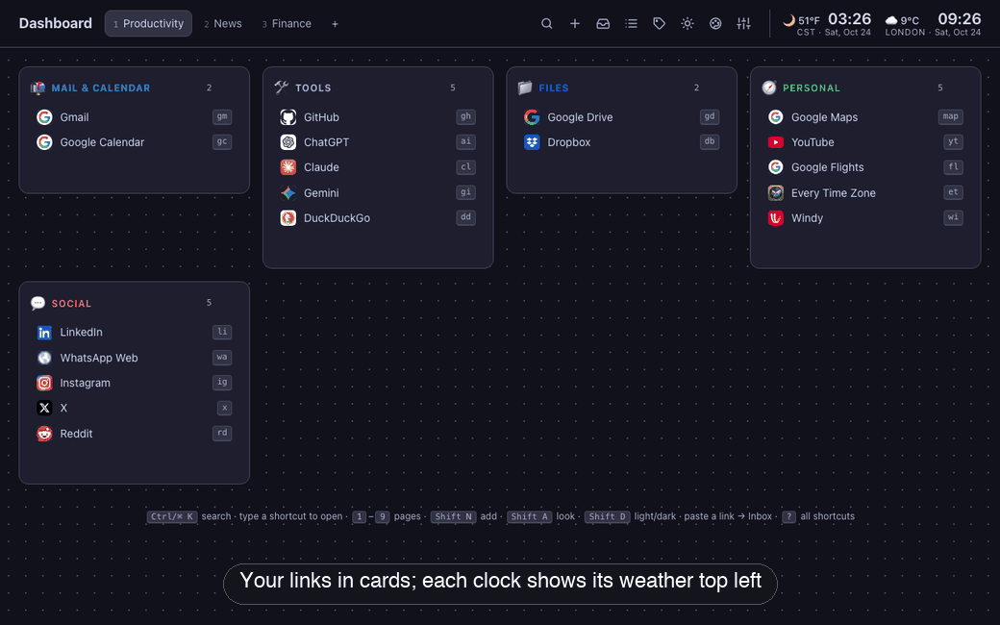
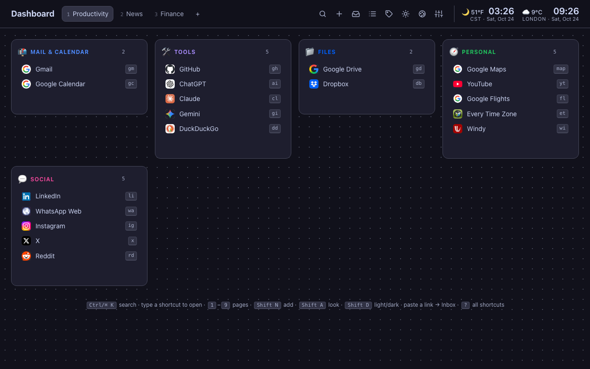

# Chevron

A personal start page in **one HTML file**. There's no server, build step, account or database. Open `index.html` in a browser and it works. Your changes are saved in the browser's `localStorage`.

It comes with three pages of links already set up — **Productivity** (Gmail, Google Calendar, Google Drive, Dropbox, GitHub, ChatGPT, Claude, Gemini, DuckDuckGo, Maps, YouTube, LinkedIn, WhatsApp, Instagram, X, Reddit, Windy weather and more), **News** (general, tech, AI and engineering blogs) and **Finance** (news, tools, commentary, economists and a group of paid sources) — and shows CST and London clocks with the local weather on the right. You can change all of these defaults by editing the file. That makes it easy to hand out one prepared dashboard to a team or class.



## Quick start

1. Download `index.html`.
2. Open it in Chrome, Edge, Firefox or Safari (double-click it, or drag it into a browser).
3. Optionally set it as your browser's home page or new-tab page.

You can also host it on any static host, such as GitHub Pages, Netlify or an internal web server. Just serve the file.

## Using the dashboard

### The screen



- **Top left:** the dashboard title (double-click to rename it) and the **page tabs**. Click a tab, or press `1`–`9`, to switch pages. Double-click a tab to rename it (`Enter` saves, `Esc` cancels). The `+` tab adds a page.
- **Top right:** the toolbar, then the **clocks**. Each clock shows the city's current weather at its top left, beside the time (e.g. `🌙 51°F  03:17`), with the city and date underneath. Click a clock for its hourly forecast, then switch to the 7-day forecast. The toolbar buttons are, from left to right:

  | Button | Does | Key |
  | --- | --- | --- |
  | Magnifier | Search everything | `Ctrl/⌘ K` |
  | Plus | Add a bookmark, category, page or widget | `Shift N` |
  | Inbox tray | Links saved for later (the badge shows how many) | `Shift I` |
  | List | The full bookmarks table | `Shift B` |
  | Tag | Tag cloud | `/` |
  | Sun / moon | Switch between light and dark | `Shift D` |
  | Palette | Look studio: themes, colours and layout | `Shift A` |
  | Sliders | Settings | `Shift S` |

- **Main area:** cards of links (called categories) and widgets. Each card's menu (`⋯`, or right-click the header) adds, sorts, resizes, moves or deletes it. Click a card's title to collapse it.
- **Bottom:** a one-line reminder of the main keys. Hide it with `Shift Z`.

### Opening links

- **Click** a link. It opens in a new tab (change this in Settings → General).
- **Type its shortcut** anywhere on the dashboard. For example, type `gm` for Gmail or `hn` for Hacker News. You don't need to click anywhere first. The shortcut shows on the right of each link, and matching links light up as you type. See [Built-in bookmarks and shortcuts](#built-in-bookmarks-and-shortcuts).
- **Search:** press `Ctrl/⌘ K`, type part of a name, tag or address, and press `Enter`. If you type something that isn't a shortcut, search opens with what you typed.
- **Hover** over a link for a moment to see its address, tags and notes.

### Adding and organising links

- **Add a link:** press `Shift N` (or the `+` button, or the `+ Add bookmark` row that appears when you hover over a card). Paste the address, and the name fills in automatically. Everything saves as you type, and `Esc` closes the panel.
- **Save a link for later:** copy a link and press `Ctrl/⌘ V` anywhere on the dashboard. It goes to the **Inbox** (`Shift I`), where you can file it into a card later.
- **Edit or delete a link:** right-click it, then choose **Edit…** or **Delete**. Deleted links go to the **Trash** (`Shift T`) for 30 days, and there's an **Undo** button straight after.
- **Rearrange:** drag links up and down or into another card. Drag a card by its header to move it. Drop a link or a card on a page tab to move it to that page.
- **New card:** press `Shift C`. **New page:** press `Shift P`. **Widget** (notes, calendar, clocks, web search): press `Shift W`.
- **Pin a link** (right-click → Pin) to show it above every page.

### Searching

Open search with `Ctrl/⌘ K`.

- **Find a bookmark:** type any part of its name, address, tags, notes or card. Use `↑` `↓` to choose and `Enter` to open. `Shift Enter` edits it instead, and `Ctrl/⌘ Enter` opens it in a new tab.
- **Search the web:** type a finder key, a space, then your query:

  | Type | Searches |
  | --- | --- |
  | `g …` | Google |
  | `d …` | DuckDuckGo |
  | `gm …` | Gmail |
  | `gh …` | GitHub |
  | `yt …` | YouTube |
  | `w …` | Wikipedia |
  | `m …` | Maps |
  | `$ …` | Google Finance |
  | `fred …` | FRED |

  Whatever you type, the last result is a Google search for it. Add your own finders in Settings → Search.
- **Run a command:** start with `:`, for example `:dark`, `:export` or `:theme`.
- **Browse tags:** start with `#`.
- **Filter:** combine words with filters like `tag:ai`, `page:finance`, `site:github.com`, `is:pinned`, `opened:never` or `added:<7d`. The full list is under [Search and command palette](#search-and-command-palette-ctrl-k).
- **Switch modes:** `Tab` switches between All, Commands, Tags and Web.

### Changing the look

Press `Shift A` for the Look studio. Choose light, dark or system mode, pick one of 13 themes, and adjust card style, fonts, backdrop, corners, columns and density. Changes apply instantly. `Shift D` switches light and dark, and `Shift R` picks a random theme.

### Keeping your data safe

Your dashboard is saved in this browser only. To move it to another computer or browser, or to keep a backup, use **Settings → Data → Export backup**, then **Import file…** on the other side.

## Built-in bookmarks and shortcuts

These come with the file. Type a shortcut on the dashboard to open the link. You can change any of them by editing the bookmark (right-click → Edit…) or the defaults block.

### Productivity page

| Card | Link | Shortcut |
| --- | --- | --- |
| Mail & Calendar | [Gmail](https://mail.google.com/) | `gm` |
| Mail & Calendar | [Google Calendar](https://calendar.google.com/) | `gc` |
| Tools | [GitHub](https://github.com/) | `gh` |
| Tools | [ChatGPT](https://chatgpt.com/) | `ai` |
| Tools | [Claude](https://claude.ai/) | `cl` |
| Tools | [Gemini](https://gemini.google.com/) | `gi` |
| Tools | [DuckDuckGo](https://duckduckgo.com/) | `dd` |
| Files | [Google Drive](https://drive.google.com/) | `gd` |
| Files | [Dropbox](https://www.dropbox.com/home) | `db` |
| Personal | [Google Maps](https://www.google.com/maps) | `map` |
| Personal | [YouTube](https://www.youtube.com/) | `yt` |
| Personal | [Google Flights](https://www.google.com/travel/flights) | `fl` |
| Personal | [Every Time Zone](https://everytimezone.com/) | `et` |
| Personal | [Windy](https://www.windy.com/) | `wi` |
| Social | [LinkedIn](https://www.linkedin.com/) | `li` |
| Social | [WhatsApp Web](https://web.whatsapp.com/) | `wa` |
| Social | [Instagram](https://www.instagram.com/) | `ig` |
| Social | [X](https://x.com/) | `x` |
| Social | [Reddit](https://www.reddit.com/) | `rd` |

### News page

| Card | Link | Shortcut |
| --- | --- | --- |
| News | [AP News](https://apnews.com/) | `ap` |
| News | [BBC News](https://www.bbc.com/news) | `bbc` |
| News | [The Guardian](https://www.theguardian.com/) | `gu` |
| Tech News | [Hacker News](https://news.ycombinator.com/) | `hn` |
| Tech News | [Ars Technica](https://arstechnica.com/) | `at` |
| Tech News | [Crunchbase News](https://news.crunchbase.com/) | `cb` |
| AI | [Anthropic News](https://www.anthropic.com/news) | `an` |
| AI | [OpenAI News](https://openai.com/news/) | `oa` |
| AI | [Google DeepMind Blog](https://deepmind.google/blog/) | `dm` |
| AI | [Latent Space](https://latent.space/) | `ls` |
| AI | [Simon Willison](https://simonwillison.net/) | `sw` |
| Engineering | [Cloudflare Blog](https://blog.cloudflare.com/) | `cf` |
| Engineering | [Stripe Engineering](https://stripe.dev/blog/topic/engineering) | `st` |
| Engineering | [Netflix Tech Blog](https://netflixtechblog.com/) | `nf` |
| Engineering | [GitHub Engineering](https://github.blog/engineering/) | `ge` |
| Engineering | [Jane Street Tech Blog](https://blog.janestreet.com/) | `js` |
| Engineering | [Meta Engineering](https://engineering.fb.com/) | `me` |
| Engineering | [Google Research Blog](https://research.google/blog/) | `gr` |

### Finance page

| Card | Link | Shortcut |
| --- | --- | --- |
| Finance News | [Reuters Business](https://www.reuters.com/business/) | `rt` |
| Finance News | [AP Business](https://apnews.com/business) | `ab` |
| Finance Tools | [Google Finance](https://www.google.com/finance/) | `gf` |
| Finance Tools | [Yahoo Finance](https://finance.yahoo.com/) | `yf` |
| Finance Tools | [TradingView](https://www.tradingview.com/) | `tv` |
| Finance Tools | [Finviz](https://finviz.com/) | `fv` |
| Finance Tools | [FRED](https://fred.stlouisfed.org/) | `fr` |
| Finance Tools | [SEC EDGAR](https://www.sec.gov/edgar/search/) | `sec` |
| Finance Tools | [Morningstar](https://www.morningstar.com/) | `ms` |
| Finance Tools | [Portfolio Visualizer](https://www.portfoliovisualizer.com/) | `pv` |
| Finance Tools | [Bogleheads](https://www.bogleheads.org/) | `bh` |
| Commentary & Data | [Abnormal Returns](https://abnormalreturns.com/) | `ar` |
| Commentary & Data | [Calculated Risk](https://www.calculatedriskblog.com/) | `cr` |
| Commentary & Data | [A Wealth of Common Sense](https://awealthofcommonsense.com/) | `wc` |
| Commentary & Data | [Of Dollars and Data](https://ofdollarsanddata.com/) | `od` |
| Commentary & Data | [Apollo Daily Spark](https://www.apolloacademy.com/the-daily-spark/) | `sp` |
| Commentary & Data | [Federal Reserve](https://www.federalreserve.gov/) | `fed` |
| Paid | [Bloomberg](https://www.bloomberg.com/) | `bl` |
| Paid | [Financial Times](https://www.ft.com/) | `ft` |
| Paid | [Wall Street Journal](https://www.wsj.com/) | `wsj` |
| Paid | [Barron's](https://www.barrons.com/) | `ba` |
| Economists | [Marginal Revolution](https://marginalrevolution.com/) | `mr` |
| Economists | [Apricitas Economics](https://www.apricitas.io/) | `ae` |
| Economists | [Claudia Sahm](https://stayathomemacro.substack.com/) | `cs` |
| Economists | [Conversable Economist](https://conversableeconomist.com/) | `ce` |
| Economists | [The Grumpy Economist](https://www.johnhcochrane.com/) | `jc` |
| Economists | [Paul Krugman](https://paulkrugman.substack.com/) | `pk` |
| Economists | [Brad DeLong](https://braddelong.substack.com/) | `bd` |
| Economists | [Adam Tooze – Chartbook](https://adamtooze.substack.com/) | `tz` |
| Economists | [Noahpinion](https://www.noahpinion.blog/) | `np` |
| Economists | [Robert Shiller Data](https://shillerdata.com/) | `rs` |
| Economists | [Peterson Institute (PIIE)](https://www.piie.com/) | `pi` |

## Changing the defaults

Near the top of `index.html` is a block that starts with:

```html
<script id="dash-defaults" type="application/json">
```

It holds plain JSON with the pages, categories, bookmarks, clocks, search finders and look settings that a first-time visitor sees:

```json
{
  "storageKey": "dashboard",
  "title": "Dashboard",
  "pages": [
    {
      "name": "Productivity",
      "categories": [
        {
          "name": "Mail & Calendar",
          "icon": "📬",
          "color": "#4f8cff",
          "bookmarks": [
            { "name": "Gmail", "url": "https://mail.google.com/", "tags": ["google", "email"], "shortcut": "gm" },
            { "name": "Google Calendar", "url": "https://calendar.google.com/", "tags": ["google", "calendar"], "shortcut": "gc" }
          ]
        }
      ]
    }
  ],
  "clocks": [
    { "label": "CST", "timeZone": "America/Chicago", "lat": 41.88, "lon": -87.63, "unit": "fahrenheit" },
    { "label": "London", "timeZone": "Europe/London", "lat": 51.51, "lon": -0.13, "unit": "celsius" }
  ],
  "settings": { "theme": "cocoa", "mode": "system" }
}
```

| Field | Meaning |
| --- | --- |
| `storageKey` | Name used for the saved data. Give each copy of the file its own key so dashboards on the same machine don't share data. Browsers often treat every local `file://` page as the same site. |
| `title` | The text in the top-left corner and the browser tab. |
| `pages[].categories[]` | Cards on a page. `type` can be `bookmarks` (the default), `notes`, `calendar`, `clock`, `weather` or `search`. Optional fields: `icon` (emoji), `color`, `span` (`1` or `2` columns), `sort` (`manual`, `name`, `count`, `opened`, `added`) and `content` (Markdown for notes). |
| `bookmarks[]` | `name`, `url`, plus optional `tags`, `shortcut`, `notes`, `pinned`, and `icon` (an emoji or image URL). |
| `inbox[]` | Optional links that start in the Inbox. |
| `clocks[]` | `label` and an IANA `timeZone`, such as `America/Chicago` (switches between CST and CDT on its own), `Europe/London` or `Asia/Singapore`. Add `lat`, `lon` and `unit` (`celsius` or `fahrenheit`) to show that city's weather. |
| `finders[]` | Site searches for the search panel. `key` is what you type, and `%s` in `url` is replaced by your query. |
| `collections[]` | Saved filters, e.g. `{ "name": "Work", "query": "tag:work" }`. |
| `settings` | Any look or behaviour setting. See [Settings reference](#settings-reference). |

**The easy way:** set the dashboard up how you want it in the browser. Then go to **Settings → Data → Copy as defaults JSON** and paste the result over the defaults block in the file.

**What happens to existing visitors:** once someone changes anything, their copy lives in their browser. If you later edit the defaults, they see a banner with three options:

- **Add new defaults** brings in links they don't already have.
- **Replace with defaults** starts them over from your new version.
- **Keep mine** leaves their copy as it is.

Visitors who never changed anything always get the latest defaults.

## Features

### Bookmarks

- **Pages** hold **categories** (cards), each with an emoji icon, a colour, a sort order and an optional double width.
- **Adding links:** use the + button, press `Shift N`, **paste a link anywhere** (it goes to the Inbox), drop a link from another window onto a card or page tab, or type a URL in search and press `Shift Enter`.
- **Side-panel editor** with three tabs. Changes save as you type.
  - **Details:** name, URL, category, tags (with suggestions), keyboard shortcut, icon, notes and pin.
  - **Health:** a score out of 100 plus checks for an invalid URL, plain http, missing tags, duplicates, links you haven't opened in a while, and reachability.
  - **Usage:** when it was added, when it was last opened, how many times, and a 30-day chart.
- **Keyboard shortcuts per bookmark:** type `gm` on the dashboard to open Gmail. Matching links light up as you type. Anything that isn't a shortcut opens search.
- **Pinned strip** above every page.
- **Hover preview** showing the address, tags, notes and usage.
- **Drag and drop** to reorder bookmarks and categories, move them between categories, or move them to another page by dropping on its tab.
- **Right-click menus** on bookmarks, category headers and page tabs.
- **Trash:** deleted items stay for 30 days (configurable) and can be restored. There's also an **Undo** button after every delete.

### Search and command palette (`Ctrl/⌘ K`)

- One box for bookmarks, commands (`:`), tags (`#`) and web search. `Tab` switches modes.
- **Filters:**
  - `tag:work`, `-tag:old`, `tag:dev*`
  - `cat:`, `page:`, `site:`
  - `is:pinned` / `inbox` / `untagged` / `never` / `dup` / `noted` / `shortcut` / `broken` / `snoozed` / `http`
  - `added:<7d`, `opened:>3m`, `opened:never`
  - `/word` (name only), `-word` (exclude)
- **Finders:** `g query` searches Google, `d query` DuckDuckGo, `gh query` GitHub, `yt query` YouTube, `w query` Wikipedia, `m query` Maps, `gm query` Gmail, `$ AAPL` a Google Finance quote and `fred cpi` FRED economic data. You can add your own in Settings → Search.
- Commands cover everything else: themes, exports, widgets, pages, reset and more.

### Bookmarks view (`Shift B`)

- Every bookmark in one table: name, location, tags, open count, last opened and health score.
- **Smart filters:**
  - Pinned, Inbox, added this week
  - Most opened, never opened, neglected
  - Duplicates, untagged, unreachable, needs attention
- **Collections:** save any filter as a collection that keeps itself up to date.
- Browse by page or category.
- Sort by name, newest, last opened, most opened, health or site. Group by category, page, tag or site.
- **Bulk actions:** move, add or remove tags, pin or unpin, check links, export CSV and delete.
- Press `h` to jump to the bookmarks that need attention.

### Inbox (`Shift I`)

- A holding area for links you haven't filed yet.
- **Piles:** all, waiting longest, new this week, with a note, and snoozed.
- **Actions:** **Promote** to a category, **Keep** (files it in "Unsorted"), **Snooze** for a day or a week, or delete.
- **Triage mode** (`t`) shows one link at a time with single-key actions: `o` open, `k` keep, `s` snooze, `d` delete, `e` edit, `p` promote, `←`/`→` to move between links.

### Tags (`/`)

- A tag cloud sized by how often each tag is used.
- Each tag's page shows its bookmarks across all pages and its related tags.
- **Rename** a tag. Renaming it to an existing tag **merges** the two.
- **Remove** a tag from every bookmark at once.

### Widgets

Add them from the + menu or with `Shift W`:

- **Notes:** Markdown with headings, lists, `- [ ]` checkboxes you can tick, bold, code and links.
- **Calendar:** a month view.
- **Clocks:** larger copies of your header clocks.
- **Weather:** current conditions and a 5-day forecast for each clock city.
- **Web search:** a search box that uses your default finder.

### Clocks and weather

- CST (`America/Chicago`) and London are on the right of the header by default. Each clock shows its current weather at the top left, beside the time, for example `☀️ 68°F  14:05`, with the city and date on the line below. Hover over a clock for the conditions and today's high and low.
- **Click a clock** (or press `Shift O`) for that city's **hourly forecast** for the next 24 hours, including the chance of rain. Switch to the **7-day forecast** with the button or `d`, back to hourly with `h`, and between cities with `←` `→`.
- Add, remove, reorder and rename clocks in **Settings → Clocks & weather**, which includes a time-zone picker, a **city search** that fills in the time zone and coordinates for you, and a **Use my location** button.
- Choose °C or °F per city, 12- or 24-hour time, and whether to show seconds and the date. Weather can be turned off entirely.
- Weather comes from [Open-Meteo](https://open-meteo.com/), a free forecast service that needs no account or API key. It refreshes at most every 30 minutes and is cached in the browser. Forecast data is licensed [CC BY 4.0](https://creativecommons.org/licenses/by/4.0/), credited as "Weather data by Open-Meteo.com".
- **Use my location** relies on the browser's location feature. Browsers usually only allow it on `https://` pages, so it may not work when you open the file directly. Searching for your city always works.

### Look studio (`Shift A`)

- **Light, dark or follow the system.** `Shift D` or the sun/moon button switches between them.
- **13 themes,** each with a light and a dark version:
  - Cocoa (default), Night City, Slate, Fjord, Dusk, Ember, Solar
  - Rose, Forest, Ocean, Sunset, Mono, Phosphor
- **Accent colour override.**
- **Card styles:** solid, glass, outline, soft shadow or terminal.
- **Category headers:** coloured text, plain, filled or underlined.
- **Fonts:** sans, monospace, serif or rounded.
- **Backdrops:** dots, grid, gradient, aurora or stripes, with an intensity slider.
- **Layout:** corner radius, column count (auto or 1–6), and compact, comfortable or spacious density.
- **Site icons** from Google's or DuckDuckGo's icon service, from each site directly, or letters only with no network requests.

### Link checks

`Shift L`, or the **Check** buttons, test whether each link answers from your browser and record the response time. A green or red dot appears next to checked links.

Browsers don't let a page read another site's status code. So this only tells you whether the site answered, not whether the page returned a 404.

### Import and export (Settings → Data)

**Import** by choosing a file or dropping it onto the page:

- A backup (`.json`)
- A page template (`.json`)
- A browser bookmarks export (`.html`) from Chrome, Firefox, Safari or Edge. Most bookmark services export this format too.
- A spreadsheet (`.csv`) with columns such as `name,url,tags,notes,category,page`
- A plain list of URLs

**Export:**

- A full JSON backup
- Browser-format HTML
- CSV of everything, or only the current filter or selection
- A single page as a shareable **template**
- The whole dashboard as **defaults JSON** for this file

### Statistics

**Settings → Statistics** shows:

- Totals for bookmarks, pages, categories, widgets, tags and opens
- How many links are in the Inbox and the Trash
- Counts of never-opened, duplicate and untagged links
- An overall cleanup score
- Your most opened links and top sites

### Other

- Changes made in one tab show up in your other open tabs right away.
- Double-click the title to rename it. Double-click a page tab to rename the page in place, or right-click it for more page options.

## Keyboard shortcuts

Press `?` or `F1` in the app for a searchable list. Shortcuts don't fire while you're typing in a box.

**Anywhere on the dashboard**

| Keys | Action |
| --- | --- |
| letters / digits | Open a bookmark by its shortcut (anything else starts a search) |
| `Ctrl/⌘ K`, `Shift F` | Search |
| `:` | Command palette |
| `/` | Tag cloud |
| `1`–`9` | Go to page 1–9 |
| `[` / `]` | Previous / next page |
| `Shift N` | New bookmark |
| `Shift C` | New category (card) |
| `Shift P` | New page |
| `Shift W` | Add a widget |
| `Shift B` | Bookmarks view |
| `Shift I` | Inbox |
| `Shift T` | Trash |
| `Shift S` | Settings |
| `Shift A` | Look studio |
| `Shift D` | Toggle light / dark |
| `Shift R` | Random theme |
| `Shift Z` | Hide or show shortcut badges and the key legend |
| `Shift L` | Check all links |
| `Shift O` | Weather forecast (same as clicking a clock) |
| `Ctrl/⌘ V` | Save a copied link to the Inbox |
| `?`, `F1` | Keyboard shortcut list |
| `Esc` | Close the top panel |

**In search**

| Keys | Action |
| --- | --- |
| `↑` / `↓` | Move through results |
| `Enter` | Open |
| `Shift Enter` | Edit the bookmark (or, for a typed address, save it to the Inbox) |
| `Ctrl/⌘ Enter` | Open in a new tab |
| `Tab` / `Shift Tab` | Switch mode: All, Commands, Tags, Web |

**In panels**

| Where | Keys | Action |
| --- | --- | --- |
| Bookmarks view | `h` | Show bookmarks that need attention |
| Weather | `h` / `d` | Hourly / 7-day forecast |
| Weather | `←` / `→` | Previous / next city |
| Inbox | `t` | Turn triage mode on or off |
| Triage mode | `o` `k` `s` `d` `e` `p` | Open, keep, snooze a week, delete, edit, promote |
| Triage mode | `←` / `→` | Previous / next link |

**Mouse**

| Action | Result |
| --- | --- |
| Right-click a link, card header or page tab | Options menu |
| Drag a link or card | Reorder or move it; drop on a page tab to move it there |
| Double-click the title | Rename the dashboard |
| Double-click a page tab | Rename the page |
| Double-click a notes widget | Edit the notes |
| Click a clock | Hourly and 7-day weather for that city |

## Settings reference

Use any of these in the `settings` object of the defaults block.

| Key | Values (default first) |
| --- | --- |
| `theme` | `cocoa`, `nightcity`, `slate`, `fjord`, `dusk`, `ember`, `solar`, `rose`, `forest`, `ocean`, `sunset`, `mono`, `matrix` |
| `mode` | `system`, `light`, `dark` |
| `accent` | `""` (theme colour) or a hex colour |
| `style` | `solid`, `glass`, `outline`, `soft`, `terminal` |
| `headerStyle` | `accent`, `plain`, `filled`, `underline` |
| `font` | `sans`, `mono`, `serif`, `rounded` |
| `backdrop` | `dots`, `none`, `grid`, `gradient`, `aurora`, `stripes` |
| `backdropIntensity` | `35` (0–100) |
| `radius` | `12` (0–24) |
| `density` | `comfortable`, `compact`, `spacious` |
| `columns` | `0` (auto) or `1`–`6` |
| `favicons` | `google`, `duckduckgo`, `site`, `off` |
| `newTab` | `true` |
| `hour12` | `false` |
| `showSeconds` / `showDate` | `false` / `true` |
| `weather` | `true` (show weather next to clocks that have a location) |
| `weekStart` | `0` (Sunday) or `1` (Monday) |
| `defaultFinder` | `g` (any finder key) |
| `showShortcuts`, `showPinned`, `previews`, `legend`, `pasteToInbox` | `true` |
| `trashDays` | `30` |

## Privacy

Everything stays in your browser's `localStorage`. The page makes only these network requests:

- **Site icons,** from the icon service you choose. Set **Icons → Letters only** to stop these.
- **Weather,** from Open-Meteo, at most every 30 minutes. Only each clock city's coordinates are sent, never your own location unless you use **Use my location**. Turn weather off in **Settings → Clocks & weather** to stop these.
- **City search,** to Open-Meteo's place search, only when you search for a city.
- **Link checks,** and only when you ask for one.

Clearing your browser's site data erases your dashboard, so use **Export backup** if you've customised a lot.

## Re-recording the tour

`docs/demo.gif` and `docs/screenshot.png` are generated from `index.html`. After changing the UI, run:

```sh
uv run tools/record-demo.py
```

It needs [uv](https://docs.astral.sh/uv/) and Microsoft Edge or Google Chrome. Each frame and its caption are listed in the script. Pass frame names (e.g. `07b-rename`) to re-render only those.

## Browser support

Any current version of Chrome, Edge, Firefox or Safari.

## License

[MIT](LICENSE)
